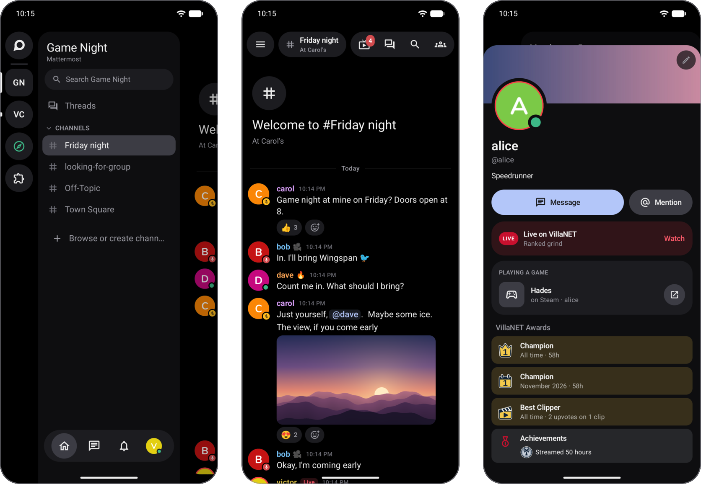
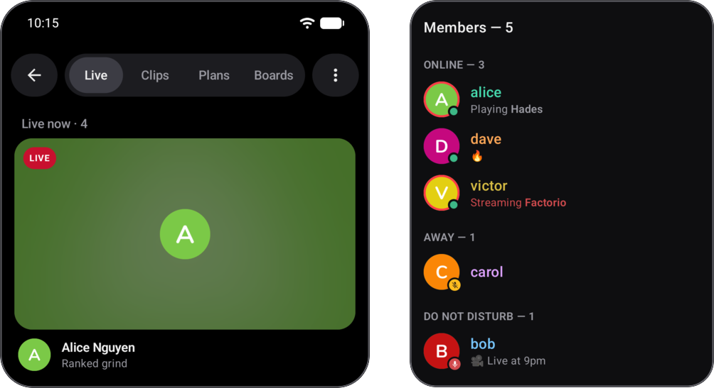

<p align="center">
  
</p>

<h1 align="center">Matty</h1>

<p align="center">A native Android app for your own Mattermost server.</p>

<p align="center">
  <a href="https://github.com/vvilla-01/matty/releases">Download</a> · <a href="#verify">Verify</a> · <a href="docs/FEATURES.md">Features</a>
</p>

<br>

<p align="center">
  <picture>
    <source media="(max-width: 600px)" srcset="docs/screenshots/hero-narrow.png">
    
  </picture>
</p>

<br>

<h3 align="center">Made for Android</h3>

<p align="center">Written from scratch in Kotlin and Jetpack Compose, for Android 17.</p>

<br>

<h3 align="center">Laid out like Discord</h3>

<p align="center">Teams on a rail, channels to one side, people to the other.<br>An OLED black theme. GIFs, when your server turns them on.</p>

<br>

<h3 align="center">Plugins, on the phone</h3>

<p align="center">Slash commands, buttons and dialogs from any plugin work in the app. <a href="https://github.com/vvilla-01/matty-plugin">Matty Plugin</a>, its companion on the server, has a module of its own: live streams, clips, and who is live and who is in voice. Each server gives the plugin a name of its own, and the app shows that name.</p>

<p align="center">
  
</p>

<br>

<h3 align="center">UnifiedPush</h3>

<p align="center">Notifications without Google, and without staying connected.<br>Matty takes them through a UnifiedPush app on the phone, such as ntfy, encrypted end to end.<br>The server needs <a href="https://github.com/vvilla-01/matty-plugin">Matty Plugin</a> 4.1.0 or newer.</p>

<br>

<h3 align="center">Get Matty</h3>

<p align="center">Download the APK from <a href="https://github.com/vvilla-01/matty/releases">Releases</a> and open it on a phone with Android 17.<br>It talks to any Mattermost server, v9 and later; it is tested on v12.<br>For live streams, the server needs <a href="https://github.com/vvilla-01/matty-plugin">Matty Plugin</a> 4.0.0 or newer.</p>

<br>

<h3 align="center">Stay up to date with Obtainium</h3>

<p align="center"><a href="https://github.com/ImranR98/Obtainium">Obtainium</a> installs Matty straight from this repository and tells you when a new version is out.<br>Add an app there and paste <code>https://github.com/vvilla-01/matty</code>.</p>

<br>

<h3 align="center">Verify</h3>

<p align="center">The only official downloads are the releases of this repository.<br>Share or paste this into <a href="https://github.com/soupslurpr/AppVerifier">AppVerifier</a> to check one:</p>

```
ceo.villa.matty
E5:52:50:BE:A6:69:00:39:B7:84:9E:33:B0:49:08:8E:CB:B9:98:D9:F2:0A:AA:8C:7E:B2:DC:5A:43:63:27:3C
75:78:CB:63:B4:3E:CC:6F:B1:27:64:51:54:F5:22:FB:15:D1:3A:26:08:E4:59:BC:F4:2A:7C:D1:41:86:A9:49
```

<p align="center">The first hash is the RSA certificate, the second the ML-DSA one.<br>Versions up to 0.1.22 were signed with a development key. Uninstall those first.</p>

<p align="center"><sub>Releases from 0.1.23 are signed with two keys together, a classical one (RSA 4096) and a post-quantum one (ML-DSA-87).<br>With the Android SDK's build-tools 37 or newer, <code>apksigner verify --verbose --print-certs matty-&lt;version&gt;.apk</code> prints the same two.<br><a href="docs/BUILDING.md#verifying-matty">More on verifying</a></sub></p>

<p align="center"><sub>In the app, Settings › Verification says whether your copy is the official build, whether your server's Matty Plugin is a release signed with the same two keys,<br>and whether that server has checked the app on Android's word. <a href="docs/PLUGINS.md#checking-each-other">What each check shows, and what it cannot</a></sub></p>

<br>

<h3 align="center">Read more</h3>

<p align="center"><a href="docs/FEATURES.md">Features</a> · <a href="docs/PRIVACY.md">Privacy</a> · <a href="docs/BUILDING.md">Building</a> · <a href="docs/PLUGINS.md">Plugins</a></p>

<br>

<p align="center"><sub>Matty is not affiliated with Mattermost, Inc.</sub><br><sub>Public domain, under <a href="LICENSE">The Unlicense</a>. Parts by others keep <a href="THIRD_PARTY_NOTICES.md">their own licences</a>.</sub></p>
