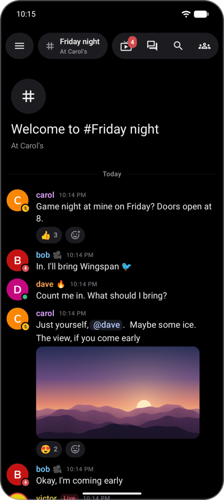
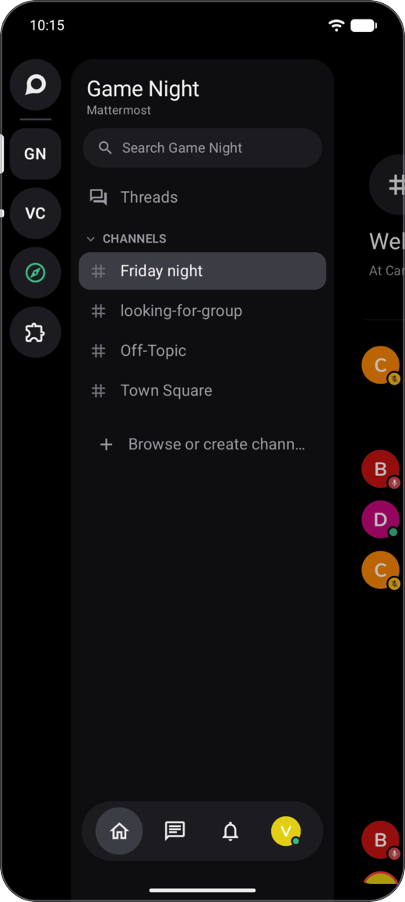
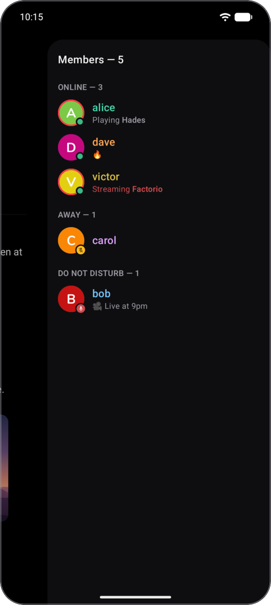

[← Back to Matty](../README.md)

# About Matty

**A social-first, native Android client for self-hosted Mattermost.**

Matty is built from scratch in Kotlin and Jetpack Compose — no WebView wrapper, no React
Native. It takes Discord's layout, MarkOut's look (OLED black, floating pills, expressive
motion), and fills the gaps the official Mattermost Android app leaves for people who run
their own server for friends, families and communities. Its launcher icon, a round chat bubble,
is drawn the way GrapheneOS draws its own apps' icons (one black symbol on white, themed-icon
ready).

  
  
  

> Matty is not affiliated with Mattermost, Inc. It talks to any Mattermost server (v9+,
> tested on v12) over the standard REST and WebSocket APIs.

## Why Matty

| | Official Android app | Matty |
|---|---|---|
| GIF picker | ✗ (desktop/web only) | ✓ Same Giphy setup as desktop: the server's key, posted as `` |
| Layout | List of channels | Discord-style: team rail, swipe panels, member list, tabs |
| Web plugins | Features disappear | Native modules (Matty Plugin first), plus commands, buttons, menus, dialogs for every plugin |
| Custom post types | "Unsupported" | Rendered natively when a module exists; a readable fallback when not |
| Notifications without Google | ✗ (needs FCM push proxy) | ✓ UnifiedPush (with Matty Plugin 4.1.0), or an optional background connection — works on GrapheneOS / de-Googled phones |
| Presence | Basic | Member list grouped by status, presence dots on chat avatars too, custom statuses everywhere, LIVE rings |
| Reactions | Long-press only | Quick-reaction bar, double-tap to react, "who reacted" sheet |

## Features

**Chat**
- Mattermost-flavoured Markdown rendered natively: emphasis, code (syntax-highlighted in
  reds on near-black, with a copy button), quotes, lists and task lists, tables, headings, autolinks, `@mentions`, `~channels`,
  `:emoji:` (including the server's custom emoji), `#hashtags`, and jumbo emoji-only messages
- Inline images and animated GIFs, file attachments, video playback, link-preview cards. Videos
  show a frame of themselves in the chat (Mattermost makes previews for pictures only, so the app
  takes one, reading just the part of the file it needs), and pictures fade in over the server's
  own blurred miniature
- The newest stretch of each conversation is kept on the device, encrypted, so a conversation
  opens at once and only what changed since is asked of the server; pictures, GIFs and video
  frames are kept the same way. Deleted messages leave the device too. Switch it off in
  Settings → Chat ("Keep recent messages on this device"), which also wipes what was kept
- Slack-style message attachments with working buttons and select menus
- Discord-style message grouping, day dividers, a "NEW" divider, mention highlighting
- Threads (collapsed reply threads) with participant faces, follow/unfollow, and inline reply
  quotes when threads are off
- Typing indicators, edit, delete, pin, save, mark unread, quote, copy link. An edit the server
  refuses (a message older than its edit window, say) stays in the box with the reason shown, and
  Edit is greyed, with why, once a message is past that window
- With a physical keyboard (a tablet's, say), Enter sends and Shift+Enter starts a new line; the
  on-screen keyboard keeps its own setting
- Composer autocomplete for `@users`, `~channels`, `:emoji:` and `/commands` (including plugin
  commands' dynamic arguments), drafts per conversation, upload-as-you-pick attachments (with a
  frame from each video, and a clear message if a picked file can't be read)
- A channel's purpose keeps its Markdown on the chat's header pill
- The message box is a floating pill, the same as the tab bar: messages scroll on behind it, and
  it rises into view with the chat as the tab pill sinks away (and back). The header pills do the
  same at the top: both slide away when you swipe to the channel list or the member list. Scrolling
  up through older messages slides the message box away too (never while you're typing), and
  scrolling back down, or reaching the newest message, brings it back
- Pills, the tab bar and full-screen views are solid to the touch: a tap that misses a button
  never lands on a message, name or row hidden behind them
- The emoji button merges into the send button while you type and floats the server's custom
  emoji just above the box (the keyboard already has the standard ones), with a live preview of
  the message as each one lands
- Full-screen photo viewer: pinch or double-tap to zoom, single tap hides everything but the photo;
  a post's photos and videos open together, to swipe through left and right

**Social**
- Team rail with unread pills and mention badges; Home space for DMs and groups. The tab pill's
  Messages button jumps to it, and Home goes back to your first server's channels
- Member list grouped Online / Away / Do not disturb / Offline with custom statuses, there the
  moment the panel opens (it is read ahead and kept, and follows people joining and leaving)
- One badge on a picture says both things: its colour is the person's presence, and a mic in it
  means they're in voice (crossed out when muted; crossed headphones when deafened)
- Profile sheets: everything at the top in one glance (handle, their local time and how far it
  is from yours, about, custom status), then Message / Mention; on your own, tap the camera to
  change your picture, or edit your profile
- Custom status with presets and "clear after", presence picker (incl. Invisible)
- Expression picker: emoji with search, recents, categories and custom emoji; GIFs via Giphy
- Colorful names, double-tap reactions, quick-reaction bar

**Plugins** — see [docs/PLUGINS.md](PLUGINS.md)
- Native module API (`MattyPlugin`): custom post renderers, full-screen panels, WebSocket
  events, profile extras, LIVE badges, outgoing-message guards, deep links
- Interactive dialogs (`open_dialog`) rendered natively; slash-command autocomplete (pick a command and it's in the box, slash and all);
  message-attachment actions
- A Plugins hub showing what the server runs and how well Matty covers each one
- **[Matty Plugin](https://github.com/vvilla-01/matty-plugin)**, Matty's companion on the server (id
  `ceo.villa.matty`), shown under the name that server gives it ("Matty" unless its admins chose
  another) on the Plugins screen, the panel's header button and title and the panel's sentences
  that name it (lines about the software itself, such as its release or that it needs an update,
  say "Matty Plugin" whatever the server calls it): live Broadcast Box streams over WHEP/WebRTC, laid out for the window: a feed of
  streams (a grid when there's room), the stream you're watching pinned with what else is live under
  it (side by side on a wide window), full screen when you turn the phone or tap the picture, a
  mini player on the other tabs and an app-wide player bar (just above the message or tab pill)
  once you leave, pull to refresh, one floating header row with the tabs, and a red
  count of who's live on its header button; the
  bearer-token unlock, who's in
  voice, up-next plans with Join, monthly/all-time boards, clips with playback and a big
  thumbs-up button, native clip and plan cards in chat (a clip pops out right over the chat), LIVE rings on streamers' avatars, a Mumble mic on the avatars of people in voice chat (in chat, the member list, DMs and profiles, beside their presence dot), what people are playing on Steam under their names in the member list and DMs, Discord-style ("Playing ELDEN RING", in place of the plugin's "Live now" badge while they stream it), with a Playing card on their profile, awards and trophies on
  profiles (crowns, monthly medals, Top Snooper, Best Clipper, biggest fans, achievement coins —
  the same record the web shows, with the plugin's own artwork), profile banners across the top
  of a profile, three wide by one high (you drag and pinch to choose the part that shows: a still
  picture is cut to it on the phone, and a GIF keeps playing with that part, kept by the
  plugin), voice channels (from Matty Plugin 4.3.0, through the plugin to the server's Mumble
  server, as Discord shows them: a Voice Channels category in each team's channel list with who
  is in each channel and a green ring while they speak, a sheet to join a channel muted or not,
  a voice screen with everybody as a tile and Mute, Deafen, the output and Leave, and a bar
  while you browse elsewhere; join a channel and talk, muted or deafened, with the call going on with Matty minimised,
  a notification with Mute and Leave, the call's output on the speaker, the phone, a headset or
  Bluetooth, and Android's call audio with echo cancelling), and the composer guard that stops
  a bearer token being posted by mistake. Streams and clips play as media (speaker/headphones),
  pause for other audio, and go quiet if headphones are unplugged. A stream keeps playing with
  Matty minimised or the screen off, for its sound (the picture nobody can see is not decoded
  meanwhile, and picks up again a moment after Matty is back), with a media notification to mute
  or stop it (and lets go by itself when the stream ends, dies, or has sat muted and unseen for
  five minutes). The app and
  Matty Plugin are written to one contract and released as a pair (Matty 0.1.31 works with
  Matty Plugin 4.0.0 or newer, and says so when it meets an older one; push notifications need
  4.1.0, voice channels 4.3.0): who is live, in voice or
  wearing the plugin's badge is decided once, on the server, and the app asks only what changed.
  Links to clips and plans posted under the plugin's earlier id, `ceo.villa.villanet`, open as
  the new ones do
- **Checking each other** ([what each check shows, and what it cannot](PLUGINS.md#checking-each-other)):
  the app checks how it is signed itself, verifies that the server's Matty Plugin is a release
  signed with the same two keys as the app (RSA and ML-DSA), and, when the server asks, proves
  itself to it with the phone's hardware key attestation. Each says what it found in one line
  in Settings → Verification; the lines about the plugin's release and the app check are also on
  the Plugins screen and in the panel's menu. When the server's admins change what its check
  accepts, the app proves itself again by itself, and a server that refuses it is shown on every
  tab of the panel with **Try again**

**Everything else**
- Sign in with password (+MFA), personal access token, or GitLab single sign-on
- Multiple servers, switchable from the You tab
- Notifications with inline reply and mark-as-read, fed by UnifiedPush (end-to-end encrypted, with no connection kept open; needs Matty Plugin 4.1.0 on the server; Settings → Notifications says how it stands for the server on screen) or by the live WebSocket; replying from one doesn't make you show as online, and a thread's notification opens that thread, and its Mark as read marks the thread read up to the newest message it showed; with more than one server signed in, each notification says which server it is from
- Share text, images and files into Matty from other apps
- Tablet / foldable layout with all three panes side by side
- OLED, Dim, Light and System themes; Material You, Matty blue or Red accent

## Roadmap

- Offline cache (Room) and faster cold start
- Voice messages; Calls
- More native plugin modules (Matterpoll results, Playbooks checklists, …)
- Message search filters UI, channel bookmarks, scheduled posts
